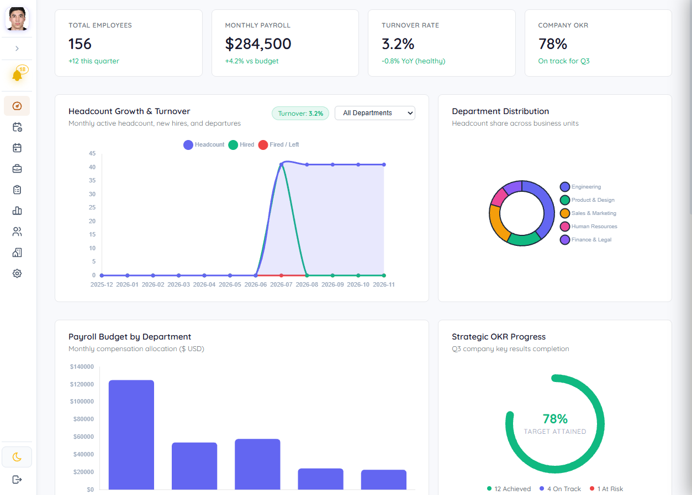
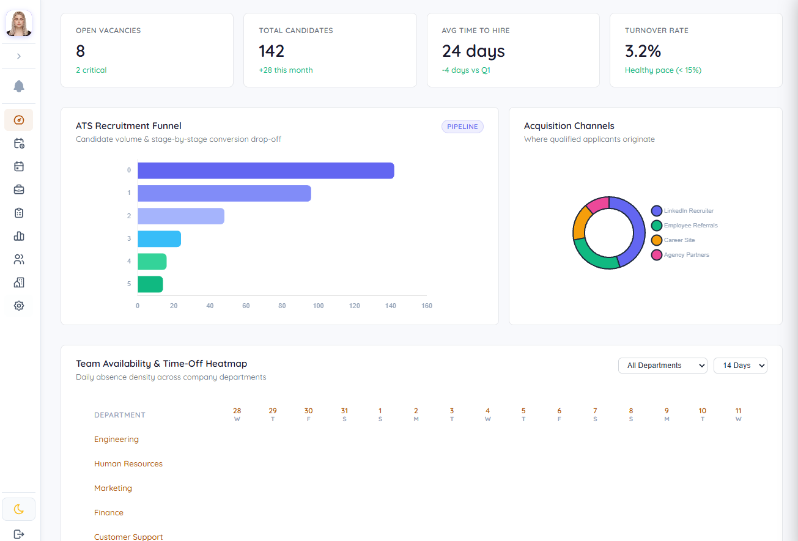
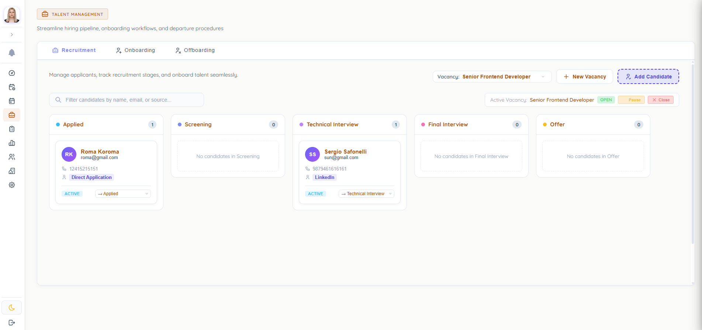
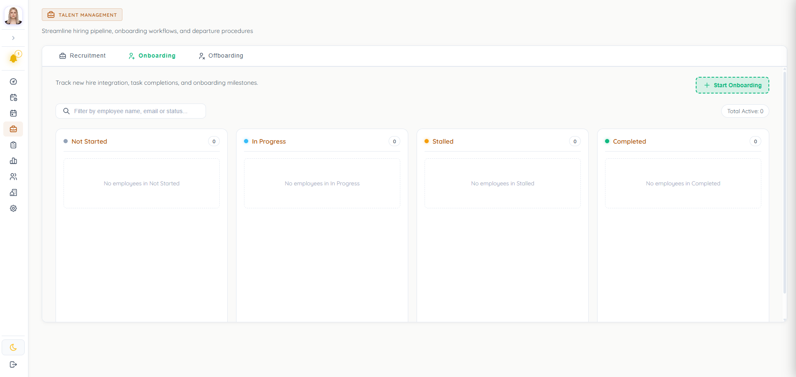
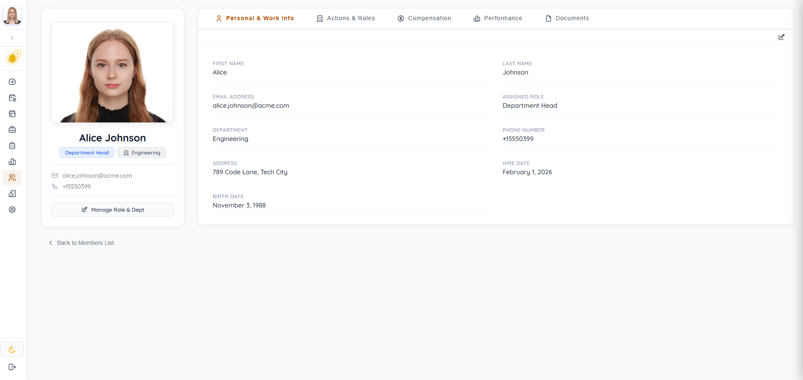
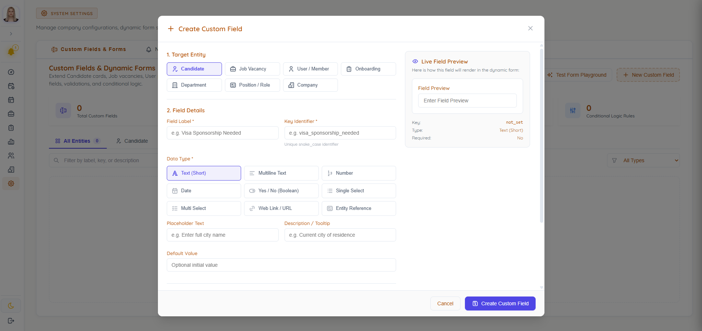
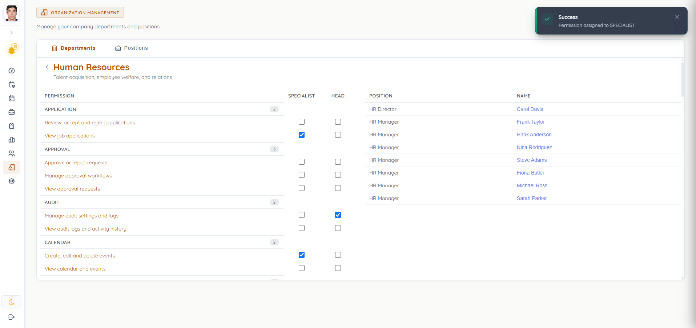
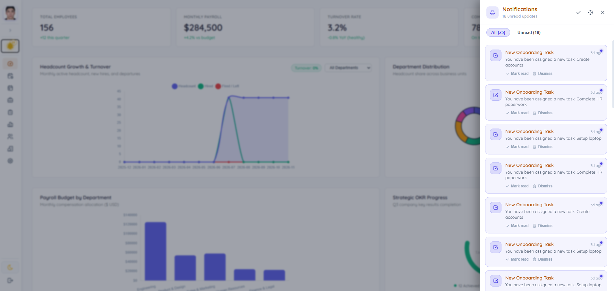
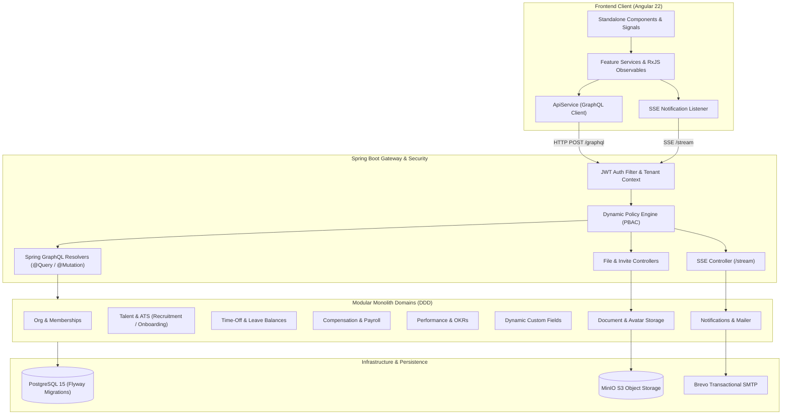

# icos — Integrated Corporate Operating System

<div align="center">

<!-- PROJECT LOGO PLACEHOLDER -->
<p align="center">
  
</p>

### Modern Enterprise Human Capital Management (HCM) & Corporate Operations Platform

[](https://openjdk.org/)
[](https://spring.io/projects/spring-boot)
[](https://graphql.org/)
[](https://angular.dev/)
[](https://www.postgresql.org/)
[](https://flywaydb.org/)
[](https://min.io/)
[](https://www.docker.com/)

<p align="center">
  <a href="#key-features">Key Features</a> •
  <a href="#ui-preview--screenshots">Screenshots</a> •
  <a href="#architecture--system-design">Architecture</a> •
  <a href="#tech-stack">Tech Stack</a> •
  <a href="#getting-started">Getting Started</a> •
  <a href="#roadmap--future-improvements">Roadmap</a>
</p>

</div>

---

## 📌 Overview

**icos** is an enterprise-grade, multi-tenant Human Capital Management (HCM) and People Operations platform designed to streamline the entire employee lifecycle. Built on a modular monolith architecture using **Java 21**, **Spring Boot**, **Spring GraphQL**, and a modern **Angular 22** frontend (Signals, Standalone Components), `icos` unifies recruitment, onboarding, performance appraisals, time-off requests, payroll tracking, and organizational governance into a single cohesive system.

---

## 🚀 Key Features

### 🏢 Organizational Architecture & Multi-Tenancy
- **Hierarchical Department Tree**: Configurable organizational hierarchy with parent-child department trees and department heads.
- **Positions & Roles**: Granular position assignments tied to compensation brackets and access policies.
- **Company Multi-Tenancy**: Built-in tenant scoping and isolated workspace management.

### 🛡️ Security, RBAC & Policy-Driven Access Control (PBAC)
- **Granular Permissions & Dynamic Rules**: Contextual security evaluation via dedicated policy rules (`AdminPolicyRule`, `DepartmentPolicyRule`, `RecruitmentPolicyRule`, `OnboardingPolicyRule`, etc.).
- **JWT Authentication with Refresh Token Rotation**: Secure cryptographic token rotation with SHA-256 token hashing, expiration policies, and device fingerprinting.
- **Secure Member Invites**: Expiring, single-use invitation tokens delivered via Brevo (Sendinblue) transactional emails.

### 🎯 Talent Acquisition & ATS (Applicant Tracking System)
- **Interactive Kanban Recruitment Board**: Drag-and-drop workflow tracking candidates across customizable recruitment stages (Screening, Technical Interview, Cultural Fit, Offer, Hired).
- **Vacancy Lifecycle Management**: Create, draft, publish, pause, and close job openings.
- **Candidate Profiles & Resumes**: Candidate document attachment, S3-backed resume storage, and interview feedback logs.

### 🔄 Employee Onboarding & Offboarding Pipelines
- **Automated Workflow Orchestration**: Process generation from standardized milestone templates upon candidate hire.
- **Milestone & Task Checklists**: Automated offset-based due dates (e.g., Day 1, Day 7, Day 30) assigned to IT, HR, or team managers.
- **Offboarding & Asset Handover**: Structured departure workflows, asset recovery checklists, and departure reason analytics.

### 🌴 Time-Off & Leave Management
- **Leave Balances & Policies**: Real-time balance calculations across leave categories (Annual Vacation, Sick Leave, Unpaid, Remote Days).
- **Approval Engine**: Configurable multi-tier manager approvals with complete audit event logs (`leave_audit_logs`).

### 💰 Compensation & Payroll Tracking
- **Salary History & Revisions**: Audit trail of compensation adjustments with effective dates, approved-by managers, and revision rationale.
- **Bonus Management**: Performance, referral, and retention bonus disbursement tracking.
- **Payroll Periods & Batch Calculations**: Draft, open, review, and finalize payroll runs with automated base and bonus aggregation.

### 📈 Performance Management & OKRs
- **Objectives & Key Results (OKR)**: Company, team, and individual goals with percentage completion, metric weights, and real-time progress calculations.
- **360° & Manager Performance Reviews**: Cycle-based review scheduling, 1–5 scale grading, and qualitative evaluation summaries.

### 🧩 Dynamic Custom Fields Engine
- **Zero-Code Entity Extensibility**: Attach dynamic custom fields (text, number, date, dropdown) to employees, departments, and vacancies.
- **Field Playground & Validation**: Live schema testing playground and client-side reactive validation.

### 📅 Corporate Calendar & Real-Time Alerts
- **Event Management**: Company holidays, team leaves, interviews, and 1-on-1s with participant RSVP statuses (Accepted, Declined, Pending).
- **Real-Time Notifications (SSE)**: Server-Sent Events stream for instant updates, notification center bell widget, and user preference controls.

### 📦 S3-Compatible Object Storage
- **MinIO Cloud Storage Integration**: Scalable document storage for passport copies, contracts, certifications, and avatar photo processing.

---

## 📸 UI Preview & Screenshots

> **Note for Contributors**: Place the corresponding screenshot images into [`docs/screenshots/`](docs/screenshots/) using the filenames listed below.

<div align="center">

### Executive & HR Operations Dashboards
| Executive / Owner Dashboard | HR & Talent Dashboard |
|:---:|:---:|
|  <br> *(Placeholder: `docs/screenshots/dashboard-owner.png`)* |  <br> *(Placeholder: `docs/screenshots/dashboard-hr.png`)* |
| *High-level company headcount, department health, and project milestones* | *Candidate pipelines, open vacancy metrics, and pending hire actions* |

### Talent Pipeline & Recruitment (ATS)
| Recruitment Kanban Board | Onboarding & Offboarding Lifecycle |
|:---:|:---:|
|  <br> *(Placeholder: `docs/screenshots/recruitment-board.png`)* |  <br> *(Placeholder: `docs/screenshots/onboarding-pipeline.png`)* |
| *Visual candidate stages, resume viewer, and status transitions* | *Automated new hire checklist tracking and asset return protocols* |

### Organization, Profile & Custom Fields
| Employee Directory & Profile | Dynamic Custom Fields Playground |
|:---:|:---:|
|  <br> *(Placeholder: `docs/screenshots/member-profile.png`)* |  <br> *(Placeholder: `docs/screenshots/custom-fields.png`)* |
| *Detailed profile, salary records, leave balance, and documents* | *Live schema builder for extending data models on the fly* |

### Organisation management, permissions
| Organization Management | Notification Center & Quick Actions |
|:---:|:---:|
|  <br> *(Placeholder: `docs/screenshots/organization-management.png`)* |  <br> *(Placeholder: `docs/screenshots/notifications.png`)* |
| *Departments, positions, and granular role/permission matrix* | *Real-time SSE event alerts and contextual approval requests* |

</div>

---

## 🏛️ Architecture & System Design

`icos` is engineered following **Domain-Driven Design (DDD)** and **Hexagonal / Clean Architecture** principles within an extensible **Modular Monolith**.



### Module Structure (Backend Clean DDD)
Each domain module inside `src/main/java/com/safo/icos/modules/` adheres to a strict separation of concerns:
```
modules/<domain>/
├── api/             # Contracts, Public DTOs, Domain Events
├── application/     # Application Services, Use Cases, Event Listeners
├── domain/          # Core Domain Entities, Aggregates, Repository Interfaces
├── infrastructure/  # Spring Data JPA Repositories, Database Entities, Mappers
└── presentation/    # GraphQL Resolvers (@QueryMapping, @MutationMapping), REST Endpoints
```

---

## 💻 Tech Stack

| Layer | Technology | Details |
|:---|:---|:---|
| **Backend Framework** | **Java 21 / Spring Boot 3.4+ / 4.0** | Spring Data JPA, Spring Security, Spring Mail, Spring AOP |
| **API Architecture** | **GraphQL & SSE** | Strongly-typed `.graphqls` schemas, GraphiQL IDE, Server-Sent Events |
| **Database & Migration** | **PostgreSQL 15 + Flyway** | 13 versioned SQL migrations with automated schema evolution |
| **Object Storage** | **MinIO (S3 Compatible)** | Distributed object storage for CVs, avatars, and legal documents |
| **Security & Auth** | **Spring Security + JJWT 0.12** | Dual-token authentication (Access JWT + Refresh Token in DB), PBAC rules |
| **Frontend Framework** | **Angular 22** | Modern Signals, Standalone Components, `inject()` API, typed forms |
| **Styling & Icons** | **SCSS + Design Tokens** | Custom SCSS theme, Ng-Icons / Tabler Icons, FontAwesome |
| **Containerization** | **Docker & Docker Compose** | Multi-container setup for DB, MinIO storage, and pgAdmin 4 |
| **Code Quality** | **Maven Checkstyle Plugin** | Strict checkstyle rules enforcement on build validation phase |

---

## 🛠️ Getting Started

### Prerequisites
- **JDK 21** or later
- **Node.js 20+** and **npm**
- **Docker & Docker Compose**
- **Git**

---

### Step 1: Clone the Repository
```bash
git clone https://github.com/SafoStudio/icos.git
cd icos
```

---

### Step 2: Configure Environment Variables
Copy the `.env.example` file to `.env` and adjust the variables if needed:
```bash
cp .env.example .env
```
Key configuration properties:
```properties
# Database
DB_HOST=localhost
DB_PORT=5435
DB_NAME=icos_db
DB_USER=safo
DB_PASSWORD=password

# JWT Security
JWT_SECRET_KEY=your-256-bit-secret-key-for-jwt-signing-must-be-changed-in-production
JWT_EXPIRATION=900000          # 15 minutes
JWT_REFRESH_EXPIRATION=604800000 # 7 days

# Object Storage (MinIO)
MINIO_ENDPOINT=http://localhost:9000
MINIO_ROOT_USER=minioadmin
MINIO_ROOT_PASSWORD=minioadmin
MINIO_BUCKET=icos-storage

# Brevo SMTP Mailer (Optional for dev)
BREVO_SMTP_USERNAME=your_login@smtp-brevo.com
BREVO_SMTP_PASSWORD=your_generated_smtp_key
INVITE_BASE_URL=http://localhost:3000/register
```

---

### Step 3: Launch Supporting Services with Docker
Run PostgreSQL, MinIO, and pgAdmin containers:
```bash
docker compose up -d
```
Verify services:
- **PostgreSQL**: `localhost:5435`
- **MinIO S3 API**: `http://localhost:9000`
- **MinIO Web Console**: `http://localhost:9001` (User: `minioadmin`, Pass: `minioadmin`)
- **pgAdmin 4**: `http://localhost:5050`

---

### Step 4: Run the Backend Application
The application automatically runs Flyway migrations and seeds demo data (`companies`, `departments`, `positions`, `users`, `memberships`) on startup:
```bash
# Windows
.\mvnw.cmd spring-boot:run

# Linux / macOS
./mvnw spring-boot:run
```
- **Backend API**: `http://localhost:8080`
- **GraphiQL Playground**: `http://localhost:8080/graphiql`

> **Tip**: You can manage database migrations anytime using the helper script:
> ```bash
> ./db.sh migrate   # Run Flyway migrations
> ./db.sh repair    # Repair schema history
> ./db.sh clean     # Reset database schema
> ```

---

### Step 5: Run the Frontend Client
Open a new terminal tab and start the Angular development server:
```bash
cd client
npm install
npm start
```
The application will launch at: **`http://localhost:4200`** (or proxy configured port).

---

## 🧪 Testing & Code Quality

### Backend Tests
Execute domain unit tests, service specifications, and security integration tests:
```bash
# Run all unit and integration tests
./mvnw test

# Validate code standards with Checkstyle
./mvnw checkstyle:check
```

### Frontend Tests
Execute the Angular test suite:
```bash
cd client
npm test
```

---

## 🧭 Project Roadmap & Future Enhancements

- [ ] **Interactive Business Analytics & Visual Charts**: Integrate Chart.js / Apache ECharts for visual turnover trends, hiring velocity funnels, and OKR burn-up charts.
- [ ] **E2E & Component Test Coverage**: Implement Playwright / Cypress for end-to-end user journey testing and comprehensive Jasmine/Karma component unit tests.
- [ ] **Live Collaboration via WebSockets / GraphQL Subscriptions**: Real-time collaborative updates on Kanban recruitment cards and task boards.
- [ ] **Audit Trail & Compliance Log**: System-wide unified audit event log for tracking sensitive permission, salary, and policy modifications (SOC2 / GDPR compliance).
- [ ] **Enterprise Security (2FA / MFA)**: Time-based One-Time Password (TOTP) two-factor authentication and IP rate-limiting.
- [ ] **CI/CD Automation**: GitHub Actions workflow for automated multi-OS builds, SonarQube quality gates, and container image releases.

---

## 📄 License

This project is licensed under the [MIT License](LICENSE) — see the LICENSE file for details.

---

<div align="center">
  <sub>Developed with ❤️ by <a href="https://github.com/SafoStudio">SafoStudio</a>. Built for scalable modern organizations.</sub>
</div>
